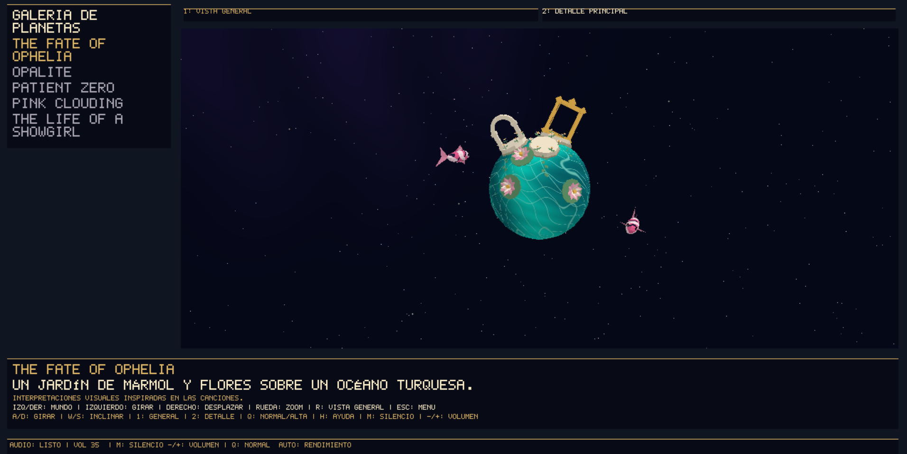
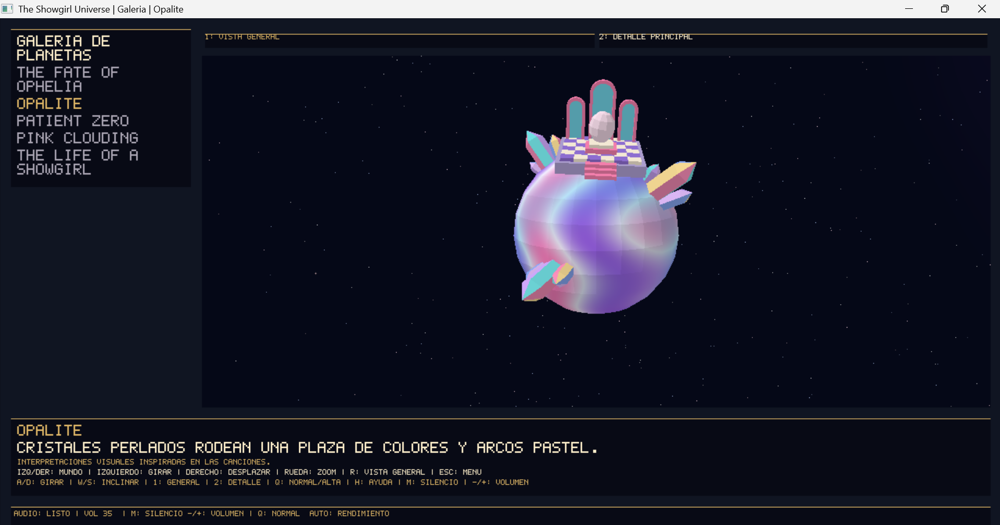
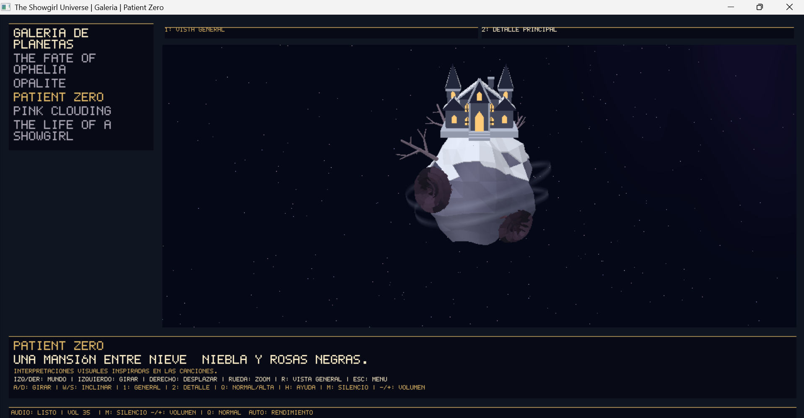
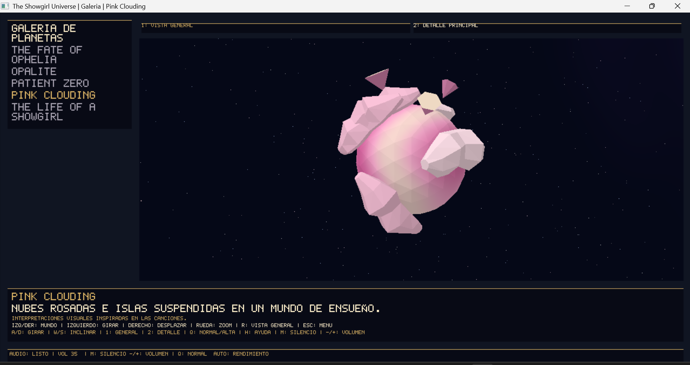
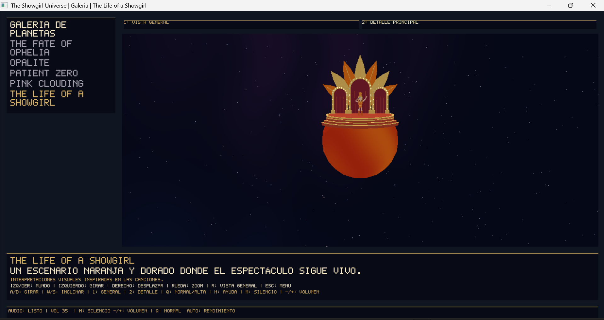
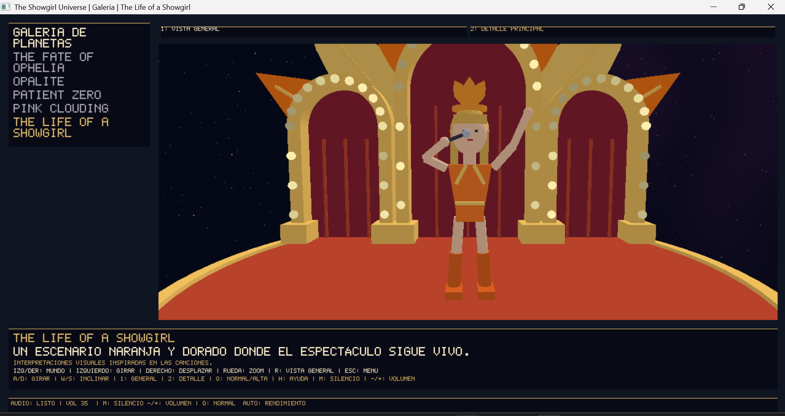
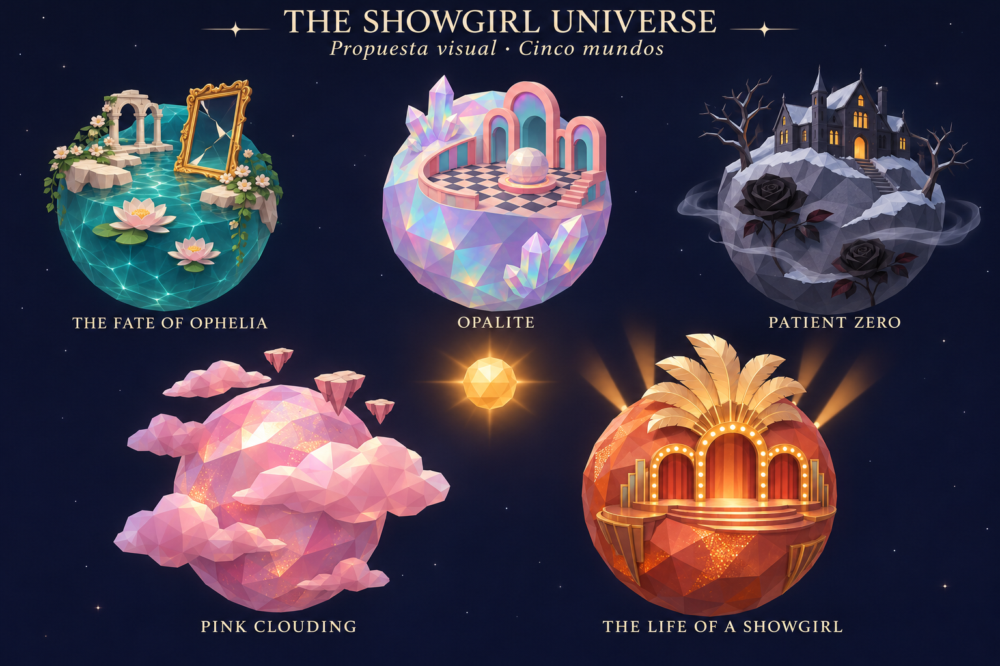
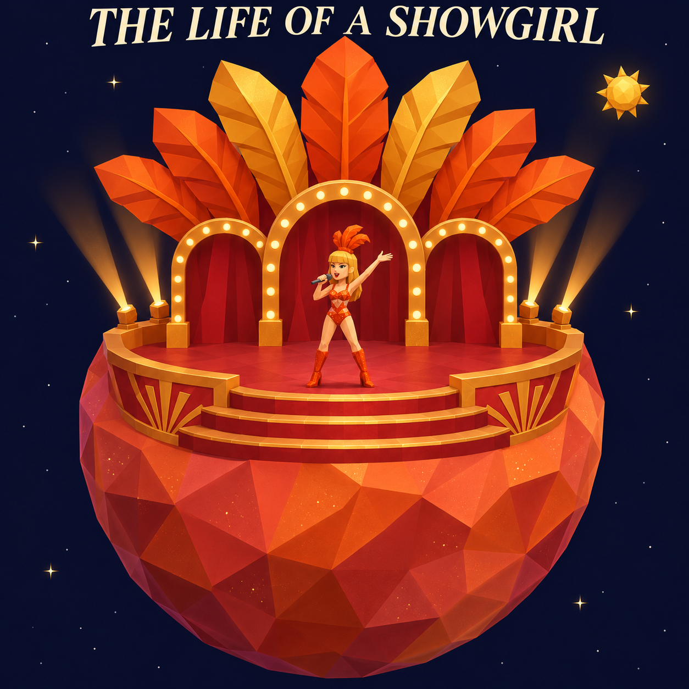

# The Showgirl Universe

Un recorrido espacial entre cinco mundos inspirados en el universo musical de **Taylor Swift**. Desde una nave se puede explorar el sistema, acercarse a cada planeta y rodearlo para descubrir jardines, cristales, una mansión nevada y un escenario de espectáculo.

El proyecto está desarrollado en **Rust**, con un renderizador de triángulos por software en la **CPU**. Los planetas combinan geometría, materiales propios y animaciones. La nave se modeló en Blender y conserva sus materiales azul y lavanda y las letras TS en la parte inferior.


**Autora:** Mishell · [bastmre44](https://github.com/bastmre44)  
**Curso:** Gráficas por Computadora · CC2018  
**Repositorio:** [Proyecto-3-CG](https://github.com/bastmre44/Proyecto-3-CG)

## Galería: capturas del programa

Las siguientes imágenes son capturas de la galería del proyecto en ejecución. Muestran el resultado del renderizador por software, con la interfaz y el encuadre elegidos al capturarlas.

### The Fate of Ophelia



Jardín de mármol, flores y koi sobre un océano turquesa.

### Opalite



Plaza de baldosas, arcos pastel y cristales alrededor de una superficie perlada.

### Patient Zero



Mansión, nieve, rosas oscuras, árboles y niebla sobre terreno irregular.

### Pink Clouding



Nubes facetadas e islas suspendidas en un mundo de tonos rosados.

### The Life of a Showgirl



Vista general del mundo naranja y su escenario rojo y dorado.

### Showgirl: detalle del escenario



Acercamiento a la intérprete, el micrófono, los arcos y las bombillas del escenario.

## Referencias de diseño

### Los cinco mundos



*Lámina conceptual utilizada para orientar colores, siluetas y decoraciones. Es una referencia de diseño, no una captura ni un resultado del renderizador.*

### Escenario Showgirl



*Propuesta de escenario, plumas, arcos, vestuario y personaje. La implementación en Rust adapta estos elementos a las mallas y materiales del proyecto; su acabado puede diferir del concepto.*

Las capturas de la galería aparecen en la sección anterior. El video del recorrido continuo se incorporará después.

## Organización del repositorio

| Ruta | Contenido |
| --- | --- |
| `README.md` | Presentación, ejecución, controles, explicación técnica y créditos. |
| `Cargo.toml` y `Cargo.lock` | Configuración y versiones de las dependencias. |
| `src/` | Renderizador, cámara, simulación, modelos procedurales, audio e interfaz. |
| `Nave_final.obj` | Geometría triangulada de la nave modelada en Blender. |
| `Nave_final.mtl` | Colores de los materiales de la nave. |
| `assets/audio/musica.mp3` | Pista musical utilizada durante la ejecución. |
| `docs/referencias/` | Láminas conceptuales utilizadas para orientar el diseño. |
| `docs/capturas/` | Capturas de los cinco planetas y del detalle del escenario Showgirl. |

Los módulos principales del renderizador son `obj_loader.rs`, `pipeline.rs`, `triangle.rs`, `framebuffer.rs`, `renderer.rs` y `shader.rs`. Los archivos `ophelia*`, `opalite*`, `patient*`, `pink_clouding.rs` y `showgirl*` contienen la geometría y el aspecto de los mundos.

## Iniciar el proyecto

Se necesita Rust y Cargo con soporte para la edición 2024. La ejecución y las pruebas interactivas se han realizado en Windows.

```bash
git clone https://github.com/bastmre44/Proyecto-3-CG.git
cd Proyecto-3-CG
cargo run --release
```

Ejecutar desde la raíz del repositorio, donde están `Cargo.toml`, `Nave_final.obj` y `Nave_final.mtl`. Blender se utilizó para modelar la nave y no es necesario para ejecutar el juego.

El menú permite **Explorar el sistema**, abrir la **Galería de planetas** o **Salir**. Se selecciona con Arriba/Abajo y se confirma con Enter.

## Los cinco mundos

| Mundo | Interpretación visual del proyecto |
| --- | --- |
| **The Fate of Ophelia** | Agua turquesa, islas de mármol, arcos y marcos dorados, flores y peces koi. |
| **Opalite** | Superficie perlada de colores cambiantes, cristales pastel y una plaza con baldosas y portales. |
| **Patient Zero** | Terreno rocoso irregular, nieve, mansión de ventanas cálidas, árboles desnudos, rosas oscuras y niebla. |
| **Pink Clouding** | Tonos rosados y crema, bancos de nubes facetadas, islas flotantes y destellos. |
| **The Life of a Showgirl** | Un mundo de mayor tamaño con escenario, escaleras, decoraciones rojas y doradas, plumas y una pequeña intérprete animada. |

Son interpretaciones artísticas para el proyecto. Los créditos distinguen estas decisiones de las referencias musicales y visuales utilizadas.

La nave se modeló en Blender y se exportó como OBJ triangulado: **263 vértices y 522 triángulos**. El cargador conserva los materiales azul y lavanda del archivo MTL. Las letras TS forman parte de la geometría inferior.

## Explorar desde la nave

| Acción | Control |
| --- | --- |
| Avanzar / retroceder | W / S |
| Girar horizontalmente | A / D |
| Inclinar el vuelo | Arriba / Abajo |
| Impulso de viaje | Shift |
| Entrar o salir del control local, cerca de un planeta | C |
| Cambiar el planeta objetivo del indicador | Tab |
| Mostrar u ocultar las órbitas | O |
| Alternar cámara normal, lateral e inferior | V |
| Restablecer la posición y orientación de la nave | R |
| Mostrar u ocultar ayuda | H |
| Alternar calidad Normal / Alta | Q |
| Volver al menú | Esc |

El control local permite rodear el planeta y variar la distancia con W/S. El indicador muestra el objetivo, su dirección y la distancia a su centro. Cambiar el objetivo con Tab no transporta la nave.

El vuelo permite acercarse, rodear y alejarse sin cambiar de escena. Las colisiones consideran límites envolventes de los cuerpos y sus decoraciones; no se calcula una colisión individual contra cada pétalo o escalón.

## Examinar los mundos en la galería

| Acción | Control |
| --- | --- |
| Seleccionar otro planeta | Izquierda / Derecha |
| Girar la cámara | Arrastrar con botón izquierdo |
| Desplazar el punto de observación | Arrastrar con botón derecho |
| Acercar / alejar | Rueda del ratón |
| Giro horizontal / inclinación | A-D / W-S |
| Vista general / detalle principal | 1 / 2 o botones de pantalla |
| Restablecer el encuadre | R |
| Alternar calidad | Q |
| Mostrar u ocultar ayuda | H |
| Volver al menú | Esc |

La galería utiliza el mismo renderizador y los mismos escenarios que el vuelo. Permite observar los detalles sin mover la nave. Al salir se conserva el estado de exploración. El reloj orbital se pausa fuera del vuelo, mientras las animaciones de la galería continúan.

## Audio

La pista del juego es **The Life of a Showgirl**, de **Taylor Swift**, y se busca en `assets/audio/musica.mp3`. Se reproduce en bucle, comienza al 25 % y continúa al cambiar de pantalla.

| Acción | Control |
| --- | --- |
| Silenciar / restaurar | M |
| Bajar / subir volumen | - / +, incluido teclado numérico |

Si falta el archivo o no se puede iniciar el dispositivo de audio, el programa muestra un aviso y permite continuar. Los créditos musicales se encuentran al final de este README. La fuente y versión del audio aún están pendientes de confirmar.

## Cómo se dibuja la escena

El renderizado 3D se implementa en Rust y se ejecuta en la CPU:

1. [obj_loader.rs](src/obj_loader.rs) lee los vértices, índices triangulados y materiales OBJ/MTL de la nave.
2. [camera.rs](src/camera.rs) y [pipeline.rs](src/pipeline.rs) aplican las matrices de modelo, vista y proyección. El pipeline recorta los triángulos en coordenadas homogéneas y convierte sus posiciones a pantalla.
3. [triangle.rs](src/triangle.rs) rasteriza con coordenadas baricéntricas e interpola atributos con corrección de perspectiva.
4. [framebuffer.rs](src/framebuffer.rs) almacena el color y la profundidad para resolver qué superficie queda visible.
5. [shader.rs](src/shader.rs) y los módulos de los mundos calculan materiales por fragmento. La niebla se mezcla con transparencia respetando la profundidad.

`glam` proporciona vectores, matrices y cuaterniones; `minifb` crea la ventana, recibe entradas y presenta el framebuffer; `rodio` decodifica y reproduce el MP3. No se utiliza un motor 3D ni funciones de rasterización 3D de GPU.

La nave procede de Blender. Las mallas y decoraciones de los mundos se construyen mediante código Rust. El programa dibuja geometría y materiales; las láminas conceptuales sirven como referencia visual y no se utilizan como texturas de los planetas.

## Movimiento y calidad

[simulation.rs](src/simulation.rs) conserva el tiempo transcurrido y actualiza la simulación en pasos de 1/120 de segundo. Así, la frecuencia de renderizado no determina directamente la velocidad del vuelo o de las órbitas. El tiempo restante se acumula para el siguiente cuadro.

Las órbitas y rotaciones están habilitadas con `INSPECTION_MODE = false` en [main.rs](src/main.rs). Cambiarlo a `true` permite revisar los planetas quietos; para el recorrido normal debe mantenerse en `false`.

La calidad **Normal** dibuja a la resolución del área 3D. **Alta** renderiza al doble de resolución en cada eje y reduce el resultado por promedio: cuatro muestras por píxel. El texto y la interfaz se dibujan a resolución nativa. Este ajuste es supersampling, no un sistema de niveles de detalle geométrico.

Alta requiere más trabajo de CPU. Se recomienda Normal para el recorrido en equipos con menor rendimiento. La galería comienza en Alta y puede pasar automáticamente a Normal si varios cuadros consecutivos tardan demasiado; elegir con Q desactiva ese ajuste automático. La ventana y los paneles se adaptan al tamaño disponible.


## Requisitos obligatorios para habilitar la evaluación

Esta tabla indica dónde se encuentra la implementación y cómo comprobarla. La validación final corresponde al docente; el video pendiente forma parte de los requisitos de entrega.

| Requisito obligatorio | Estado | Evidencia y forma de comprobarlo |
| --- | --- | --- |
| Pipeline propio de software, sin motor gráfico, motor de física ni funciones de dibujo 3D de GPU | Implementado | Transformación y recorte en [pipeline.rs](src/pipeline.rs), rasterización en [triangle.rs](src/triangle.rs), color y profundidad en [framebuffer.rs](src/framebuffer.rs). `glam` aporta operaciones matemáticas y `minifb` presenta el framebuffer. |
| Sol, nave de modelado propio y al menos un planeta con órbita y rotación dependientes del tiempo | Implementado | Sol y cinco mundos en [main.rs](src/main.rs). La nave se modeló en Blender y se carga desde `Nave_final.obj` y `Nave_final.mtl`. Las posiciones orbitales y matrices de rotación dependen del reloj de [simulation.rs](src/simulation.rs); `INSPECTION_MODE` debe permanecer en `false`. |
| Acercarse, rodear y alejarse de un planeta sin cambiar de escena, con control de nave y cámara | Implementado; pendiente de mostrar en el video | En **Explorar el sistema**, acercarse con el vuelo, pulsar C cerca del planeta para rodearlo y después alejarse. [flight.rs](src/flight.rs), [local_orbit.rs](src/local_orbit.rs) y [camera.rs](src/camera.rs). La galería es complementaria y no sustituye este recorrido. |
| Cargar y dibujar modelos 3D usando matrices de modelo, vista y proyección, prueba de profundidad y al menos un fragment shader propio | Implementado | Carga OBJ/MTL en [obj_loader.rs](src/obj_loader.rs), matrices en [pipeline.rs](src/pipeline.rs), profundidad en [framebuffer.rs](src/framebuffer.rs) y materiales por fragmento en [shader.rs](src/shader.rs). |
| Entregar código fuente, recursos necesarios, instrucciones de ejecución y un video corto del recorrido |implementado| Código y modelos en el repositorio, instrucciones en este README y capturas en `docs/capturas/`. El enlace al video del recorrido continuo sigue pendiente en la sección **Video de demostración**. |


## Características que se solicita evaluar

La siguiente tabla relaciona las funciones implementadas.

| Característica | Dónde observarla | Código principal |
| --- | --- | --- |
| Cinco planetas distinguibles, con órbita y rotación | Exploración del sistema; galería para comparar sus diseños | [main.rs](src/main.rs), módulos de cada mundo |
| Modelos de superficie de distintos tipos | Flores, árboles, cristales, edificios y escenario | [ophelia_garden.rs](src/ophelia_garden.rs), [opalite_plaza.rs](src/opalite_plaza.rs), [patient_garden.rs](src/patient_garden.rs), [showgirl_stage.rs](src/showgirl_stage.rs) |
| Decoraciones orientadas sobre la superficie y vinculadas a la rotación | Rodear un planeta y observar sus construcciones | [renderer.rs](src/renderer.rs), [main.rs](src/main.rs), módulos de escenarios |
| Shaders diferenciados | Agua de Ophelia, perlado de Opalite, roca de Patient Zero y koi | [shader.rs](src/shader.rs), [ophelia.rs](src/ophelia.rs), [opalite.rs](src/opalite.rs), [patient_zero.rs](src/patient_zero.rs), [koi.rs](src/koi.rs) |
| Materiales animados | Agua, reflejos y destellos durante la ejecución | [shader.rs](src/shader.rs), [sparkle.rs](src/sparkle.rs) |
| Deformación de geometría | Relieve irregular de Patient Zero | [patient_zero.rs](src/patient_zero.rs) |
| Generación de mallas y subdivisión | Esferas y geometría de los escenarios | [sphere.rs](src/sphere.rs), [showgirl_mesh.rs](src/showgirl_mesh.rs), [pink_clouding.rs](src/pink_clouding.rs) |
| Control local continuo | Acercarse a un planeta y pulsar C | [local_orbit.rs](src/local_orbit.rs) |
| Aceleración, frenado y giro progresivos | Vuelo libre y liberación de controles | [flight.rs](src/flight.rs), [simulation.rs](src/simulation.rs) |
| Colisiones básicas | Intentar atravesar el sol o un planeta | [collision.rs](src/collision.rs), [main.rs](src/main.rs) |
| Composición y claridad de interacción | Menú, indicadores, ayuda y galería | [screens.rs](src/screens.rs), [ui.rs](src/ui.rs), [navigation.rs](src/navigation.rs) |

## Recorrido de demostración

1. Abrir **Explorar el sistema** y mostrar la disposición del sol y los planetas.
2. Seleccionar un objetivo con Tab y acercarse utilizando el vuelo.
3. Entrar en control local con C cuando el indicador lo permita y rodear el planeta.
4. Mostrar detalles desde varios ángulos y comprobar el límite de colisión.
5. Alejarse y salir del control local para continuar el vuelo, sin cambiar de escena.
6. Como complemento, abrir después la galería y mostrar los detalles de los cinco mundos.

La galería complementa la demostración; no sustituye el recorrido continuo desde la nave.

## Video de demostración

Las capturas de los cinco mundos y del detalle Showgirl ya están incluidas en la galería de este README.

**Pendiente:** agregar el enlace al video que muestre el acercamiento, la vuelta alrededor de un planeta y el alejamiento en vuelo continuo. El video se incorporará antes de cerrar la entrega.


## Parámetros para explorar el código

Estos ajustes se editan en los archivos indicados y se aplican al volver a ejecutar `cargo run --release`. No son opciones de la línea de comandos ni controles de edición en vivo.

| Parámetro | Archivo | Qué modifica |
| --- | --- | --- |
| `INSPECTION_MODE` | [main.rs](src/main.rs) | Con `true`, fija el tiempo orbital para inspeccionar los planetas; con `false`, activa sus órbitas y rotaciones. |
| `Planet.radius` | [main.rs](src/main.rs), definición de los planetas | Escala de cada mundo. |
| `Planet.orbit_radius` | [main.rs](src/main.rs), definición de los planetas | Distancia de la órbita respecto al sol. |
| `Planet.orbit_speed` y `Planet.orbit_phase` | [main.rs](src/main.rs), definición de los planetas | Velocidad y posición inicial en la órbita. |
| `Planet.rotation_speed` | [main.rs](src/main.rs), definición de los planetas | Velocidad de rotación propia. |
| `STEP_SECONDS` | [simulation.rs](src/simulation.rs) | Duración del paso de simulación, actualmente 1/120 de segundo. |

Al modificar escalas u órbitas, hay que volver a revisar la separación entre cuerpos, las colisiones y el encuadre de cámara.

## Comprobación

```bash
cargo fmt --check
cargo check
cargo test
```

En la última ejecución compartida durante la revisión: **66 pruebas aprobadas, 0 fallidas y 3 omitidas**. Las omitidas corresponden a exportaciones visuales y a una prueba interactiva de ventana. Este resultado describe esa revisión; al modificar el código se deben ejecutar de nuevo las comprobaciones.

La prueba `audio::tests::mp3_real_se_decodifica` necesita el MP3 local. Si se revisa una copia sin música:

```bash
cargo test -- --skip audio::tests::mp3_real_se_decodifica
```

Para exportar vistas de revisión con el renderizador real, sin abrir ventana ni reproducir audio:

```bash
cargo test --release exportar_galeria -- --ignored --nocapture
```

Los archivos PPM se guardan en el directorio temporal del sistema. Sus nombres incluyen dimensiones e índice, por ejemplo `showgirl_gallery_1000x650_0.ppm`. También se generan vistas de detalle para comparar Normal y Alta.


## Créditos

### Autoría y contribuciones

**Mishell · [bastmre44](https://github.com/bastmre44)**

- Modelado de la nave en Blender y exportación de su geometría y materiales.
- Selección del tema, los nombres de los mundos, las referencias musicales y la dirección visual.
- Decisiones sobre colores, edificios, jardines, nubes, escenario y detalles de los planetas.
- Integración de cambios y revisión de las distintas versiones mediante pruebas del programa.

Los escenarios y sus decoraciones se construyen con código Rust. Su proceso de desarrollo y la asistencia recibida se describen al final de esta sección.

### Taylor Swift y referencias artísticas

Se reconoce a **Taylor Swift** como la referencia artística central de *The Showgirl Universe*. El concepto se inspira en *The Life of a Showgirl*, en las referencias seleccionadas de sus ediciones y material audiovisual, y en las canciones e ideas elegidas durante la planificación de los cinco escenarios.

**The Fate of Ophelia, Opalite, Patient Zero, Pink Clouding y The Life of a Showgirl** son los nombres utilizados para los mundos del proyecto. La combinación de escenarios, objetos y colores constituye una interpretación artística; no se presenta como una recreación oficial de las portadas o los videos. Los peces koi también conservan una referencia visual explorada durante la etapa inicial inspirada en *Midnights* y *Lavender Haze*.

La pequeña intérprete del escenario Showgirl es una representación estilizada inspirada en Taylor Swift y en la estética de espectáculo utilizada como referencia. No es un modelo oficial ni un recurso extraído de un videojuego o video musical.

Este es un **proyecto académico sin fines de lucro**, sin afiliación ni patrocinio de Taylor Swift o de los titulares de las obras de referencia. Las canciones, grabaciones, portadas y videos pertenecen a sus respectivos titulares; los créditos no transfieren derechos de uso o redistribución.

### Música del juego y de la demostración

| Uso | Pista y acreditación | Archivo o estado |
| --- | --- | --- |
| Música durante la ejecución | **The Life of a Showgirl — Taylor Swift**. La versión exacta y la fuente del archivo están pendientes de confirmar. | `assets/audio/musica.mp3` |
| Música del video de demostración | Pendiente de confirmar si se utiliza la misma pista u otra grabación. | Se completará al incorporar el video. |

La canción del juego se reproduce en bucle como acompañamiento de la exploración. No se reclama autoría de la grabación ni se incluye como una composición original del proyecto. Su uso tiene una finalidad académica y no comercial.

### Herramientas y dependencias

| Recurso | Uso | Referencia |
| --- | --- | --- |
| Rust y Cargo | Desarrollo, dependencias y compilación. | [Rust](https://www.rust-lang.org/) |
| glam 0.30.9 | Operaciones con vectores, matrices y cuaterniones. | [Documentación](https://docs.rs/glam/0.30.9/glam/) |
| minifb 0.28.0 | Ventana, teclado, ratón y presentación del framebuffer. | [Documentación](https://docs.rs/minifb/0.28.0/minifb/) |
| rodio 0.21.1 | Decodificación y reproducción del MP3. | [Documentación](https://docs.rs/rodio/0.21.1/rodio/) |
| Blender | Modelado y exportación de la nave. | [Blender](https://www.blender.org/) |

Cada dependencia conserva su licencia y autoría. El uso de estas herramientas no implica participación de sus autores en el proyecto.

### Material del curso

Los materiales de **Gráficas por Computadora, CC2018**, publicados por Erick Marroquín en [CookieLab, curso 2026/2](https://cookielab.cc/courses/2026/2/cc2018), se utilizaron como referencia conceptual para framebuffer, rasterización, cámara, matrices, profundidad y shaders.

La galería, el audio y la interfaz complementan el trabajo de renderizado y no se presentan como contenidos necesariamente desarrollados en clase.


Se utilizó **ChatGPT y Codex**, para apoyar la generación y adaptación de partes del código, la corrección de errores, las pruebas y la documentación. La asistencia abarcó componentes del renderizador.


Las dos láminas de `docs/referencias/` fueron **generadas con IA como arte conceptual** durante la planificación. Se incluyen para mostrar el punto de partida visual. No son capturas del juego, no son renders realizados en Blender y no se utilizan como texturas de los planetas.
